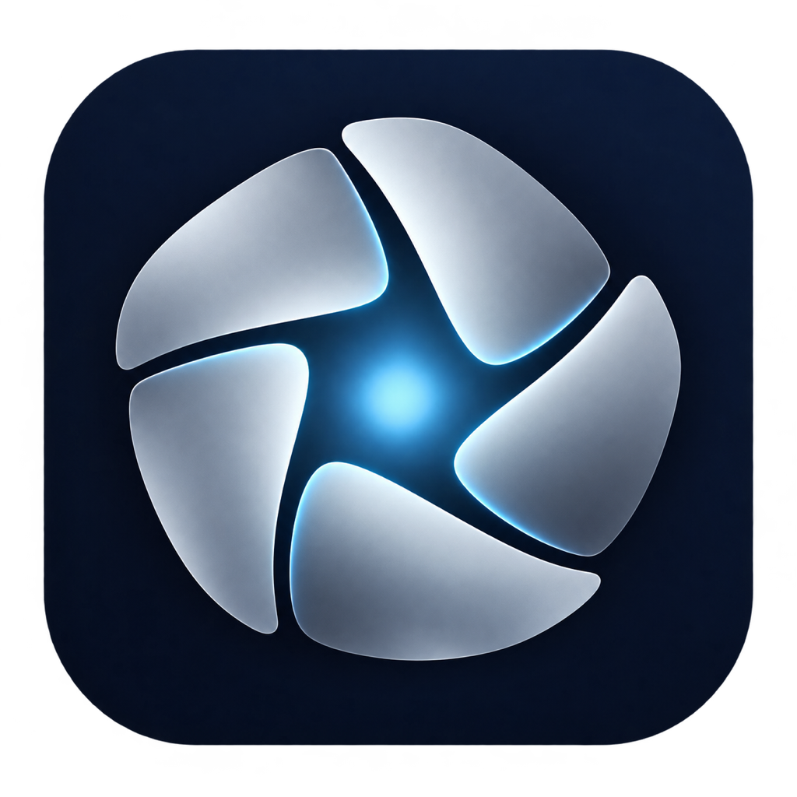

<h1 align="center">Synodica</h1>

<strong>One workspace for AI teammates to discuss, plan, build and review.</strong>

<a href="README.zh-CN.md">简体中文</a> · <a href="docs/en/getting-started.md">Getting started</a> · <a href="docs/zh-CN/subscriptions/README.md">Provider and subscription setup</a>

Synodica brings multiple model providers and reusable AI personas into a shared workspace. Give each role its own provider, model and working style, then collaborate in direct chats, groups or projects. The goal is a traceable path from a question to a reviewed result, with people deciding what proceeds.

## Start in a few steps

1. Install the desktop build for your platform from [Releases](https://github.com/Autumnpoem/Synodica/releases), or [run Synodica from source](docs/en/getting-started.md).
2. In **Settings → Providers**, connect the accounts or API keys you intend to use. CLI subscriptions use the official CLI login on the machine running the backend; a website login does not become API access.
3. Open **Settings → Team → Default teams** and choose a starting preset. Review the provider and model defaults before saving.
4. Start with a direct conversation, then create a group or project when you want several roles to work together.

| Preset | Good starting point | What you can adjust |
|---|---|---|
| **Company** | Product planning, implementation, delivery and review | Each new persona's provider and model defaults; saved roles can be edited in their profiles |
| **Laboratory** | Research planning, evidence analysis, reproducible work and peer review | Each new persona's provider and model defaults; saved roles can be edited in their profiles |

Both presets contain five reusable personas. Reapplying a preset reuses saved roles instead of overwriting names, instructions or model choices. No model IDs are hard-coded in this overview; use the models available to your account.

## Ways to work together

- **Direct chat:** work one-to-one with a selected persona.
- **Group chat:** one `@Name` and a direct message stay exclusive to that person for the reply round. Invite the whole group with `@everyone` or an explicit request such as “Everyone, please weigh in”; invitations include unmuted members, up to 12. Ordinary routing selects 1–3 relevant roles.
- **Projects:** describe the goal, choose participating roles and use the project board for planning, critique, task ownership, independent review and evidence.
- **Open-floor planning discussion:** before the plan critic and decision owner decide, eligible project members can each take one read-only turn to raise evidence-based objections. The default limit is six invitees (configurable from 1–12). The lead must record a reasoned disposition for every objection; skipped replies do not imply agreement.
- **Stop and correct:** interrupt active work with a correction. Small changes can continue; scope changes wait for you to resume or re-plan. Stopped discussion resumes with unanswered participants; a correction supersedes results from the old revision.
- **Choose your interface:** use the desktop app or browser. A Mac/Windows client and phone browser can share one Ubuntu-hosted office when they connect to the same HTTPS server and sign in with its office token.
- **Switch language:** choose English or 简体中文 in the app.

### Discussion settings and boundaries

In **Settings → General → Plan discussion**, choose **Auto**, **On** or **Off** and set the participant limit. **Auto** enables discussion when a project includes a built-in Company or Laboratory persona; it leaves custom-only projects unchanged. **On** and **Off** explicitly override that default.

Muted members, the lead and the designated critic are not discussion invitees. A profile that cannot be kept read-only is also omitted from this planning pass; for example, a write-capable Gemini CLI profile is still available in ordinary chat and implementation, but is not silently reconfigured to join planning discussion. Non-blocking participant failures do not stop the other turns. Every requested discussion turn, including a skipped turn, uses one model turn and may consume provider usage.

After discussion, the critic reviews the plan and the lead decides. Each objection keeps its original claim and reason with a recorded outcome: accepted, rejected, unresolved or needs your decision. Unresolved dissent remains in project context. If an objection needs your decision, provide a reason for resolving it and explicitly press **Start**; the project waits for you.

## Install and learn

For a hands-on introduction—including the `Synodica-0.5.1-mac-arm64.dmg` and `Synodica-0.5.1-win-x64.zip`, source install commands, account setup, mobile access and troubleshooting—see [Getting started](docs/en/getting-started.md). Desktop builds are unsigned; macOS builds are not notarized, and Windows hardware testing is pending. Do not disable operating-system security protections to install them.

- [Provider and subscription setup](docs/zh-CN/subscriptions/README.md)
- [Ubuntu shared-office deployment](docs/zh-CN/Ubuntu部署.md)
- [Desktop app, companion and usage window](docs/zh-CN/桌面端与新功能.md)
- [Company and laboratory personas](docs/zh-CN/默认团队与提示词.md)

The browser UI can run locally with Node.js 22 or newer. Follow the [source setup guide](docs/en/getting-started.md) for the supported install and build steps. For shared access, deploy the backend on Ubuntu behind HTTPS; desktop and mobile clients connect to the same office. Local offices remain separate and do not merge automatically.

## Project status

The target release is **0.5.1**. Usage visibility reflects provider data that is actually available; it does not invent missing quota values. Known limits include no live Google-account quota report for Gemini subscriptions, no independent dsh-pet chat service, unsigned desktop packages, and no Windows hardware acceptance yet.

## Credits and license

Synodica builds on [OpenGrokBot](https://github.com/Z4YT0N/OpenGrokBot) by Mahmoud Amr (FortuneCode). The upstream project's MIT rights and notices remain in [licenses/OpenGrokBot-MIT.txt](licenses/OpenGrokBot-MIT.txt). The desktop companion uses [PC2005-cloud/dsh-pet](https://github.com/PC2005-cloud/dsh-pet); third-party notices are in [THIRD_PARTY_NOTICES.md](THIRD_PARTY_NOTICES.md).

Synodica's original contributions are source-available under [PolyForm Noncommercial 1.0.0](LICENSE), with required attribution in [NOTICE](NOTICE). Noncommercial use, modification and redistribution are permitted under that license and its notice requirements. **Redistribution, modified releases and shared application packages must credit Synodica, retain the original repository link, NOTICE and license, and state the source. Commercial use of Synodica's original contributions requires separate permission.** This project is **not OSI-approved open source**. Upstream OpenGrokBot remains under MIT with its own rights and notices; see [licenses/OpenGrokBot-MIT.txt](licenses/OpenGrokBot-MIT.txt) for that separate license.
